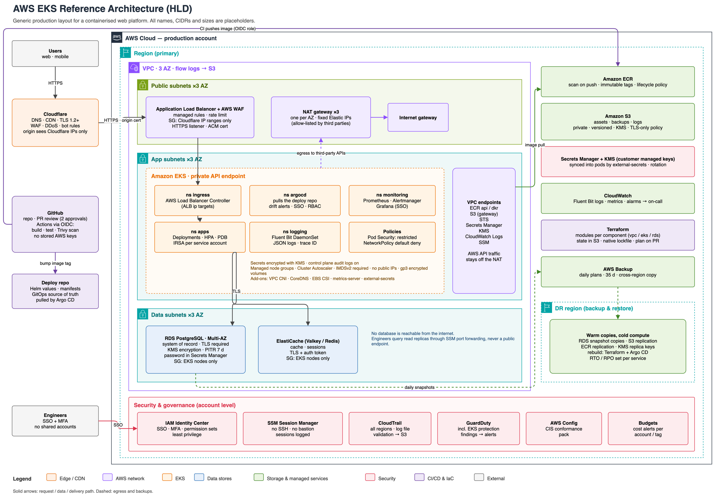

# aws-eks-reference-architecture

A one-page high-level design (HLD) for running a containerised web platform on Amazon EKS:
edge, network, cluster, data tier, delivery pipeline, security and backup on a single
diagram, with the reasoning behind each choice.

It is a reference layout, not a client design. Every name, CIDR and size is a placeholder;
a real project starts from this and adjusts it to the workload, budget and compliance needs.

Source: [`docs/architecture.drawio`](docs/architecture.drawio). Open it in
[draw.io](https://app.diagrams.net) or the desktop app to edit.

## Request path

1. **Cloudflare** terminates TLS for users, applies WAF, DDoS and bot rules, and forwards to the origin.
2. **ALB + AWS WAF** in the public subnets accepts traffic only from Cloudflare IP ranges
   (security group), with managed rules and rate limits as a second layer.
3. **AWS Load Balancer Controller** registers pods as ALB IP targets; services run in the
   `apps` namespace in private subnets.
4. **RDS PostgreSQL** (Multi-AZ) and **ElastiCache** sit in data subnets and accept connections
   only from the EKS node security group, over TLS.
5. Outbound calls to third-party APIs leave through **one NAT gateway per AZ** with fixed
   Elastic IPs, so partners can allow-list them. AWS API traffic uses **VPC endpoints** instead.

## Delivery path

| Step | What happens |
|---|---|
| Pull request | Review with two approvals; CI builds, runs tests and scans the image with Trivy |
| Merge | GitHub Actions assumes an AWS role through OIDC (no stored keys) and pushes the image to ECR |
| Release | CI bumps the image tag in the deploy repo |
| Deploy | Argo CD pulls the deploy repo and syncs the cluster; drift raises an alert |
| Infrastructure | Terraform modules per component, state in S3 with native locking, plan on every PR |

## Design decisions

| Decision | Why |
|---|---|
| Cloudflare in front, ALB locked to Cloudflare IPs | The origin cannot be reached directly, so edge WAF and DDoS rules cannot be bypassed. |
| Private EKS API endpoint, no public node IPs | Nothing in the cluster is reachable from the internet except through the ALB. |
| NAT gateway per AZ with fixed EIPs | One AZ failing does not cut egress, and partners get a stable IP list. |
| VPC endpoints for ECR, S3, STS, Secrets Manager, KMS, Logs, SSM | Image pulls and AWS API calls stay inside AWS, and NAT data charges drop. |
| IRSA per service account | Each workload gets only the AWS permissions it needs; no node-wide credentials. |
| Pod Security `restricted` + NetworkPolicy default deny | A compromised pod cannot run as root or talk to services it does not need. |
| Secrets in Secrets Manager, synced by external-secrets | No secrets in Git or container images; rotation does not need a redeploy of manifests. |
| GitOps with Argo CD | The cluster state is what is in Git; every change has a reviewed commit and can be rolled back. |
| SSO + MFA through IAM Identity Center, SSM Session Manager | No shared accounts, no SSH keys, no bastion host; every session is logged. |
| CloudTrail, GuardDuty (with EKS protection), AWS Config | Audit trail, threat detection and configuration drift checks at the account level. |
| AWS Backup with cross-region copy, RDS PITR | Point-in-time restore for operator errors, and a copy outside the primary region. |
| Backup-and-restore DR (warm data, cold compute) | Lowest standing cost; the stack is rebuilt in the DR region with Terraform and Argo CD. |

## Not covered here

Sizing, cost estimates, multi-account landing zone layout, and service-specific details
(queues, search, object processing). Those depend on the workload and are decided per project.

## Related

- [terraform-aws-baseline](https://github.com/HotdogWang/terraform-aws-baseline): Terraform layout for a VPC, EC2, RDS and S3 baseline with an import workflow and CI
- [docker-monitoring-stack](https://github.com/HotdogWang/docker-monitoring-stack): Prometheus, Alertmanager and Grafana with tested alert rules
- [vps-docker-caddy-template](https://github.com/HotdogWang/vps-docker-caddy-template): single-server deploy with Docker, Caddy and Ansible hardening

## License

MIT
